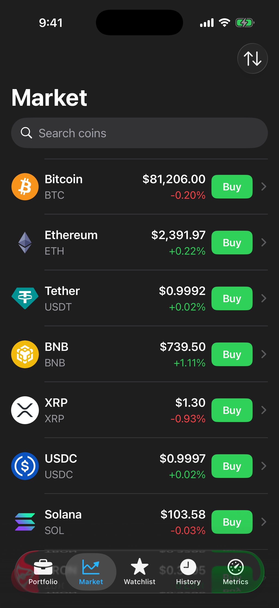
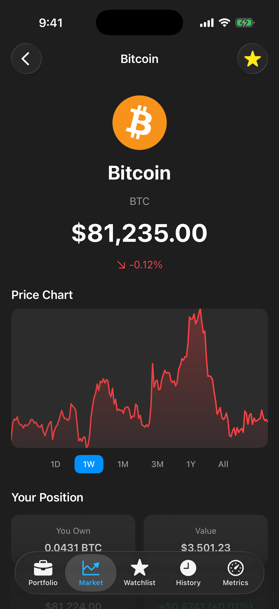
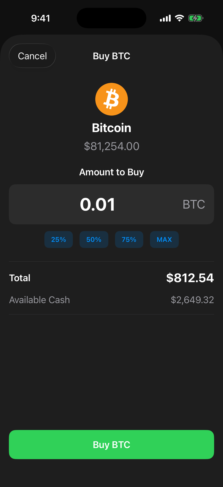
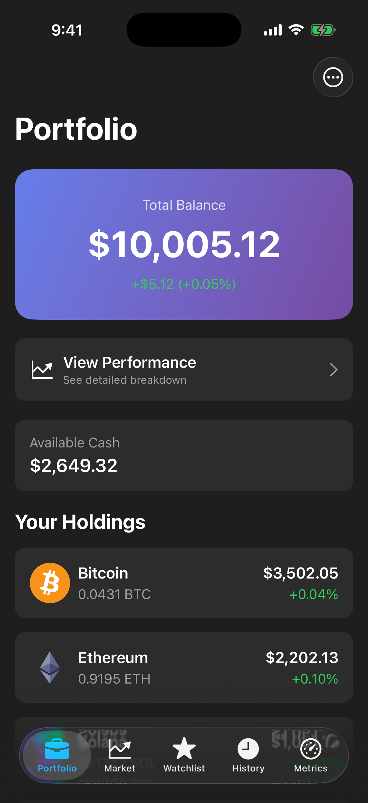
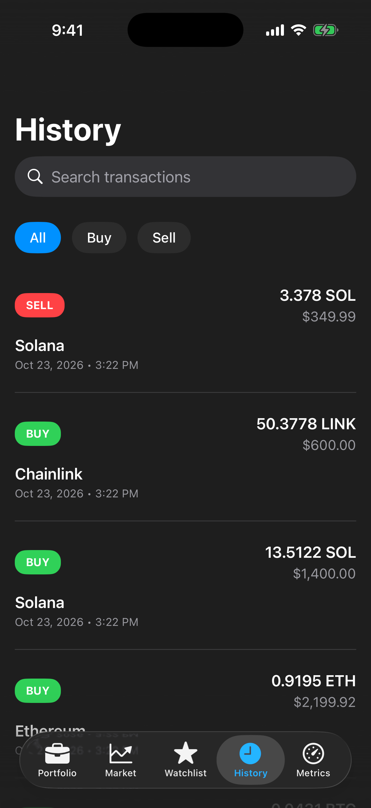

# CryptoSim

An iOS app for paper-trading crypto: you start with $10,000 of simulated cash and buy and sell the top 30 coins at live CoinGecko prices.

<p>
  
  
  
  
  
</p>

Built with SwiftUI and SwiftData. It started as my final project for COSC 4355 (iOS development) at the University of Houston; v2 is a rewrite I did after working on iOS at WhatsApp Payments. [docs/IMPROVEMENTS.md](docs/IMPROVEMENTS.md) lists what changed from v1 and why.

## What it does

- **Market**: top 30 coins by market cap, search, four sort modes, pull to refresh, buy from the row
- **Coin detail**: price chart with six ranges (1D to All), market stats, and a "Your Position" section (amount, value, average cost, P&L) when you hold the coin
- **Trading**: buy/sell sheet with live validation, 25/50/75/MAX quick fills, and a confirmation step
- **Portfolio**: total balance, cash, holdings with P&L, performance breakdown, reset to $10K
- **Watchlist** and **History** (filterable by buy/sell, searchable)
- **Metrics tab** (Debug builds only): API latency p50/p95, error rate, per-endpoint breakdown, and the analytics event stream

## Running it

Requirements: Xcode 16.4 or later and an iOS 18.5+ simulator. Tested with Xcode 26.5 on an iPhone 17 simulator (iOS 26.5).

1. Open `CryptoSim.xcodeproj`.
2. Select the **CryptoSim** scheme and an iPhone simulator.
3. Run (Cmd-R).

No API key or configuration is needed. The app uses CoinGecko's public endpoints, which are rate limited; if you hit the limit, the app keeps showing the last data it loaded and says so.

## Architecture

MVVM with constructor injection. Views render state; view models hold per-screen logic; two long-lived stores hold shared state; everything below them sits behind a protocol.

- **Dependency injection via protocols.** `CryptoSimApp.init` is the only place concrete types are built. `NetworkClient`, `MarketDataProviding`, and `AnalyticsTracking` are protocols, so tests swap in mocks or stubs at any layer. No singletons.
- **Networking with typed errors and backoff.** `URLSessionNetworkClient` maps responses to an `APIError` enum (rate limited, server, transport, decoding). Transient failures (5xx, network) retry with exponential backoff; 429s are never retried.
- **Request coalescing and caching.** `MarketStore` keeps one in-flight refresh task, so a timer tick and a pull-to-refresh share a single request. Results are cached for 30 seconds, and the auto-refresh timer pauses while the app is in the background.
- **SwiftData persistence.** Holdings, transactions, watchlist, and cash are SwiftData models owned by `PortfolioStore`. Trades throw typed `TradeError`s (for example `insufficientFunds(needed:available:)`). If the persistent container fails to open, the app falls back to in-memory storage instead of crashing.
- **Concurrency.** Stores and view models are `@MainActor`; networking is async/await. The chart uses `.task(id:)` so switching ranges cancels the previous request.
- **Debug metrics screen.** Every request records its latency and outcome in `MetricsCollector`; analytics events go through a typed `AnalyticsEvent` enum. The Metrics tab shows both, and `os.Logger` categories make the same data filterable in Console.app.

More detail: [ARCHITECTURE.md](docs/ARCHITECTURE.md), [OBSERVABILITY.md](docs/OBSERVABILITY.md).

## Testing

73 XCTest unit tests in 7 suites, running in under a second. They cover the portfolio math (average cost, cash conservation, oversell and overspend rejection), trade validation, search and sort, the refresh lifecycle, retry and rate-limit behavior, and decoding against a real CoinGecko response fixture. SwiftData tests use in-memory containers, and networking tests use a `URLProtocol` stub, so nothing hits the network.

Run them with Cmd-U in Xcode, or:

```bash
xcodebuild -project CryptoSim.xcodeproj -scheme CryptoSim \
  -destination 'platform=iOS Simulator,name=iPhone 17' test
```

See [TESTING.md](docs/TESTING.md) for what each suite covers and what isn't tested yet.

## Project layout

```
CryptoSim/
├── App/            Entry point (composition root), tab container, tab router
├── Models/         Codable API models and SwiftData models
├── Networking/     NetworkClient protocol, URLSession implementation, endpoints, errors
├── Services/       MarketDataProviding protocol and the CoinGecko implementation
├── Stores/         MarketStore (shared market state), PortfolioStore (user state)
├── ViewModels/     MarketViewModel (search/sort), TradeViewModel (validation)
├── Views/          One folder per feature plus shared components
├── Observability/  Logging, analytics, metrics, metrics dashboard
├── Utilities/      Cached formatters
└── Support/        Theme
CryptoSimTests/     Unit tests, mocks, API fixture
docs/               Architecture, testing, observability, v1-to-v2 changes
```

## What I'd do next

- Switch money values from `Double` to `Decimal`. `Double` is acceptable for a simulator with display-only values, but it's the wrong type for real money.
- Add an XCUITest for the buy, portfolio, history flow, and snapshot tests for the chart renderer.
- Move the stores from `ObservableObject` to `@Observable`.
- Replace the hand-drawn `Path` charts with Swift Charts to get axes, scrubbing, and VoiceOver support.
- Paginate the market list beyond the top 30 and add an image cache for coin icons.
- Keep the trade sheet's header visible while the keyboard is up; on smaller screens the coin icon slides under the navigation title.
